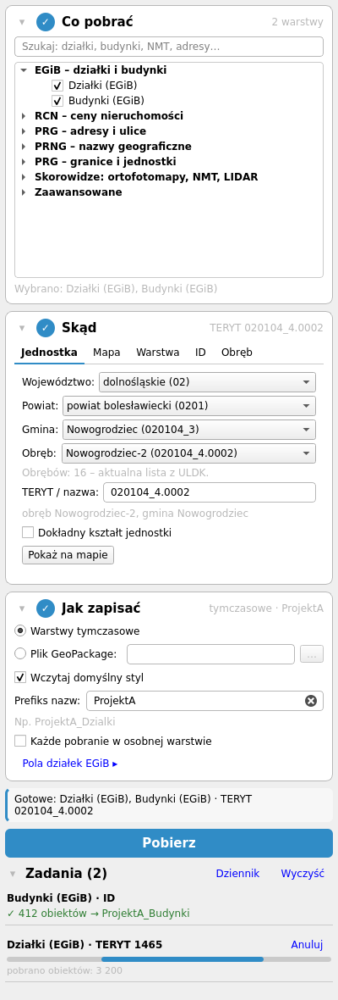
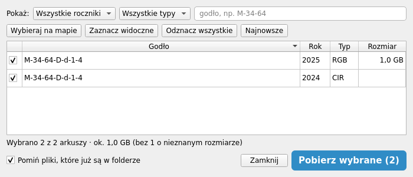

#  Pobierz dane GUGiK

Wtyczka QGIS do pobierania danych z usług Głównego Urzędu Geodezji i Kartografii: działek i budynków z EGiB, cen transakcyjnych z RCN, granic i adresów z PRG, nazw geograficznych z PRNG, plików ortofotomapy, LIDAR i NMT ze skorowidzów oraz danych z powiatowych usług WFS zgłoszonych do EZiUDP.

Wtyczka prowadzi przez trzy kroki – **co pobrać → skąd → jak zapisać** – i pobiera dane w tle, więc QGIS nie zamarza nawet przy dużych zakresach.

*English: a QGIS plugin for downloading data from the Polish Head Office of Geodesy and Cartography (GUGiK) – cadastral parcels and buildings, real estate prices, administrative boundaries, addresses, place names, orthophoto/LIDAR/DEM sheets and county WFS services – through a three-step panel and Processing algorithms.*

<p align="center"></p>

## Wymagania

- QGIS **3.40 LTR** lub nowszy, w tym **QGIS 4** (Qt6)
- dostęp do internetu; serwer proxy ustawiony w QGIS (*Ustawienia → Opcje → Sieć*) jest używany automatycznie
- interfejs po polsku albo po angielsku – według języka QGIS (każdy język inny niż polski dostaje wersję angielską)

## Instalacja

*Wtyczki → Zarządzanie wtyczkami → Wszystkie*, wyszukaj **Pobierz dane GUGiK** i kliknij *Zainstaluj*. Panel otwiera się przyciskiem na pasku narzędzi albo z menu *Wtyczki → Pobierz dane GUGiK*.

## Jak pobrać dane

### 1. Co pobrać

Zaznacz warstwy na liście albo wpisz fragment nazwy w polu wyszukiwania.

| Grupa | Dane |
|---|---|
| EGiB | działki, budynki (usługa zbiorcza) |
| RCN | działki, budynki i lokale z cenami transakcyjnymi |
| PRG | punkty adresowe, ulice, place, granice jednostek administracyjnych i ewidencyjnych, granice morskie |
| PRNG | urzędowe i pozostałe nazwy miejscowości oraz obiektów fizjograficznych |
| Skorowidze | ortofotomapa, prawdziwa ortofotomapa, LIDAR, NMT i NMPT (KRON86 i EVRF2007) |
| Usługi powiatowe (EZiUDP) | osnowa (BDSOG), EGiB z punktami granicznymi, użytkami i konturami, RCN, BDOT500 – prosto z usług WFS powiatów |

### 2. Skąd

| Zakładka | Zakres |
|---|---|
| **Jednostka** | województwo, powiat, gmina albo obręb – z list albo przez wpisanie kodu TERYT lub nazwy. Lista obrębów gminy pochodzi z ULDK, więc jest aktualna. |
| **Mapa** | bieżący widok, narysowany prostokąt albo dowolny wielokąt (lewy klik dodaje wierzchołek, prawy klik / dwuklik / Enter kończy, Backspace cofa, Esc anuluje) |
| **Warstwa** | obiekty warstwy poligonowej (lub tylko zaznaczone); wynik jest przycinany dokładnie do ich kształtu |
| **ID** | lista identyfikatorów, np. działek `146501_1.0001.23`; działają symbole `*` i `?` |
| **Obręb** | nazwa albo kod obrębu i numery działek |

Wybrany zakres podświetla się na mapie, zanim cokolwiek zostanie pobrane. Kod TERYT spoza słownika wtyczki (np. nowy obręb) też działa – sprawdza go granica z PRG.

### 3. Jak zapisać

- **Warstwy tymczasowe** albo **plik GeoPackage** – kolejne pobrania dopisują się do warstw bez powtórzeń.
- **Prefiks nazw**, np. `ProjektA` – warstwy `ProjektA_Dzialki`, `ProjektA_Budynki` w podgrupie *GUGiK/ProjektA*. Wygodne, gdy zbierasz dane do kilku zadań naraz.
- **Każde pobranie w osobnej warstwie** – zamiast dopisywania, np. `Dzialki_1465_1`, `Dzialki_1465_2`.
- **Domyślny styl** – warstwy dostają gotowe style QML.
- Dla działek EGiB można wybrać tylko potrzebne pola.

Wyniki trafiają do grupy **GUGiK** w drzewie warstw. W *Właściwościach warstwy → Metadane* zapisany jest adres usługi, zakres i historia pobrań z datami.

Kroki zwijają się kliknięciem w nagłówek. Zwinięty krok pokazuje skrót wyboru.

### Zadania

Pod przyciskiem **Pobierz** widać postęp każdego zadania i liczbę pobranych obiektów. Obiekty pojawiają się na mapie już w trakcie pobierania (porcjami co kilka sekund). Zadanie można anulować – to, co już pobrano, zostaje w warstwie. Gdy część zapytań się nie powiedzie, przycisk **Ponów** powtarza tylko je. Komunikaty błędów mówią, co się stało i co zrobić (limit czasu, błąd serwera, proxy, certyfikat). Szczegóły są w *Dzienniku komunikatów*, zakładka **PD_GUGiK**.

## Skorowidze: ortofotomapa, LIDAR, NMT

<p align="center"></p>

Po wyszukaniu arkuszy w zakresie wszystkie zasięgi pojawiają się na mapie jako warstwa, a wybrane są podświetlone. Arkusze wybierasz:

- kliknięciem na mapie (**Wybieraj na mapie**), w tabeli albo zwykłymi narzędziami zaznaczania QGIS,
- filtrem rocznika, typu (np. RGB/CIR) i godła,
- przyciskiem **Najnowsze**, który dla każdego godła zostawia najnowszy rocznik.

Pod tabelą widać łączny rozmiar wybranych plików. Pliki już obecne w folderze docelowym są pomijane i tylko wczytywane na mapę.

## Powiatowe usługi WFS (EZiUDP)

Grupa *Usługi powiatowe (EZiUDP)* w kroku 1 pobiera dane z usług WFS zgłoszonych przez powiaty do Ewidencji Zbiorów i Usług Danych Przestrzennych: osnowę poziomą i wysokościową (BDSOG), EGiB (działki, budynki, punkty graniczne oraz użytki gruntowe i kontury klasyfikacyjne – jeśli powiat je udostępnia), RCN i BDOT500. Pola zostają takie, jak podaje powiat.

Działa to tak samo jak dla usług zbiorczych: zakres wybierasz w kroku 2 (jednostka, mapa albo warstwa – wtyczka sama ustala, których powiatów dotyczy), zapis w kroku 3, a postęp widać na liście zadań. Każdy powiat trafia do osobnej warstwy, np. `Dzialki_1465`. Gdy usługa któregoś powiatu nie odpowie, **Ponów** powtarza tylko ten powiat.

## Algorytmy Processing

W *Przyborniku Processing → Pobierz dane GUGiK* są trzy algorytmy do modeli, trybu wsadowego i skryptów:

- **Pobierz dla jednostki (TERYT)**
- **Pobierz dla zasięgu warstwy**
- **Pobierz według listy identyfikatorów** (z tekstu albo z pola tabeli)

Z wiersza poleceń:

```
qgis_process run pobierz_dane_gugik:pobierz_id -- SOURCE=0 IDS="146501_1.0001.23" OUTPUT=dzialki.gpkg
```

## Dla programistów

```
core/        katalog źródeł, filtry FES, klient WFS, parser GML, zapis warstw, zadania w tle, ULDK
ui/          panel (dock.py), kroki i zadania (widgets.py), skorowidze (sheets.py), styl Qt (style.qss)
processing/  dostawca i algorytmy Processing
data/        style QML i słownik jednostek (jednostki.json.gz)
tests/       testy pytest z udawanymi usługami WFS, PRG i ULDK
i18n/        tłumaczenie angielskie (.ts i .qm)
tools/       budowanie paczki, odświeżanie słownika, tłumaczenia, zapis próbek z usług
```

**Testy** działają na prawdziwym QGIS bez okna, z udawanymi usługami (bez sieci):

```
QT_QPA_PLATFORM=offscreen python -m pytest tests
```

Środowiska QGIS 3.40 i 4.x najprościej postawić z conda-forge, np. `micromamba create -n q4 -c conda-forge qgis pytest requests`.

**Przed wydaniem:**

1. Uruchom `tools/odswiez_slowniki.py` (w konsoli Pythona QGIS albo z wiersza poleceń), żeby odświeżyć słownik województw, powiatów, gmin i obrębów z PRG. Skrypt wypisze zmiany do changelogu.
2. Opcjonalnie `tools/zapisz_probki.py` – zapisuje prawdziwe odpowiedzi usług do `tests/fixtures/live/`, na których testy sprawdzają parser.
3. `python tools/tlumaczenia.py` – zbiera napisy z kodu do `i18n/PD_GUGiK_en.ts` i buduje `.qm`; wypisze napisy bez angielskiego odpowiednika (uzupełnia się je w pliku `.ts`). Test pilnuje, żeby tłumaczenie było kompletne.
4. `python tools/build_zip.py` – paczka do repozytorium QGIS w `dist/` (bez testów i narzędzi).

Paczka przechodzi kontrole repozytorium QGIS: Bandit, detect-secrets, skaner zgodności z Qt6.

Błędy i propozycje: [zgłoszenia na GitHubie](https://github.com/GlownyUrzadGeodezjiIKartografii/pobierz_dane_GUGiK/issues).

## Historia zmian

Najnowsza wersja: **1.9.19**. Każdą wersję można rozwinąć. W QGIS (*Wtyczki → Zarządzanie wtyczkami*) widać tylko krótkie podsumowanie bieżącego wydania.

### Co nowego od 1.3.0

Wersje 1.9.x to praktycznie nowa wtyczka – ta sama nazwa i ustawienia, nowy panel i nowy rdzeń pobierania:

| Obszar | Co się zmieniło |
|---|---|
| **Panel** | trzy kroki: co pobrać → skąd → jak zapisać; wszystkie pobierania w tle, z anulowaniem i ponawianiem nieudanych zapytań |
| **Zakres** | jednostka z aktualną listą obrębów z ULDK, widok mapy, prostokąt, dowolny wielokąt, warstwa, lista ID, obręb i numer działki |
| **Pobieranie** | kaflami – bez luk w danych; obiekty pojawiają się na mapie w trakcie pobierania |
| **Usługi powiatowe** | EZiUDP w tych samych trzech krokach, z użytkami gruntowymi i konturami klasyfikacyjnymi EGiB |
| **Skorowidze** | arkusze na mapie, wybór kliknięciem, filtry rocznika i typu, rozmiar plików |
| **Zapis** | warstwy tymczasowe lub GeoPackage, grupa GUGiK, prefiks nazw, osobne warstwy, metadane pobrania |
| **Processing** | algorytmy dla TERYT, zasięgu warstwy i listy ID |
| **Język i sieć** | interfejs po polsku i angielsku; proxy z ustawień QGIS |
| **Wymagania** | QGIS 3.40 LTR lub nowszy, pełna zgodność z QGIS 4 |

### 1.9 — nowa wtyczka, droga do 2.0

<details open>
<summary><b>1.9.19</b> – Obiekty na mapie w trakcie pobierania</summary>

- Obiekty pojawiają się na mapie w trakcie pobierania: pierwsza porcja od razu, kolejne co ok. 2 s (obiekty przygotowywane w tle, w głównym wątku tylko dopisanie); usługi powiatowe – każda gotowa warstwa od razu
- Anulowanie zostawia w warstwie to, co już pobrano, i pokazuje „Przerwano. Zapisano obiektów: N”
- **Poprawka:** „Ponów” przy „osobnej warstwie dla każdego pobrania” dopisuje do warstwy tego pobrania zamiast tworzyć nową (`Dzialki_…_2`); tak samo „Pobierz mimo to” (bez ponownego pobierania już zapisanych zapytań)
- Jeden wpis w metadanych warstwy na pobranie; mniejsze zużycie pamięci przy dużych zakresach
- **Bezpiecznik kafli:** usługa, która ignoruje BBOX, albo ponad 4000 kafli – dalej zwykłe stronicowanie zamiast setek tysięcy zapytań (ostrzeżenie w dzienniku)

</details>

<details>
<summary><b>1.9.18</b> – Liczba obiektów z <code>resultType=hits</code> dla każdego kafla</summary>

- **Poprawka:** braki w EGiB/RCN – usługa nie podaje liczby obiektów, więc wtyczka pyta o nią każdy kafel zapytaniem `resultType=hits`; gdy serwer oddaje na stronę mniej obiektów, niż jest w kaflu (limit serwera), kafel jest dzielony dalej
- Gdy usługa nie obsługuje `resultType=hits` albo podaje złą liczbę, wtyczka po pierwszej próbie działa jak dotąd (pełna strona = dziel kafel); w dzienniku `PD_GUGiK` widać, który sposób zadziałał
- To samo dla usług powiatowych (EZiUDP)

</details>

<details>
<summary><b>1.9.17</b> – Kafle także dla EGiB i RCN, słownik PRG z 10.11.2026</summary>

- **Poprawka:** luki w działkach i budynkach EGiB/RCN – usługi zbiorcze (MapServer) nie podają liczby obiektów (`numberMatched="unknown"`), więc kafle z 1.9.14 się nie włączały i zostawało stronicowanie; teraz pełna strona bez liczby też dzieli zakres na kafle
- **Poprawka:** ostrzeżenie o dużym pobraniu i postęp w procentach działają też dla EGiB/RCN (liczba z zapytania `resultType=hits`)
- **Poprawka:** pobieranie nie zawiesza się na usłudze, która ignoruje `startIndex` i nie podaje liczby obiektów
- **Poprawka:** usługi powiatowe – cały powiat, który w kaflach dał 0 obiektów (np. inna kolejność osi), jest ponawiany dostawcą WFS QGIS jak przed 1.9.15
- Usługi powiatowe dla całego województwa pytają przed startem (wszystkie powiaty pobierane w całości)
- **Język:** gdy w QGIS wyłączone jest „Zastąp ustawienia regionalne”, wtyczka idzie za językiem systemu jak QGIS; nazwy zadań w menedżerze zadań QGIS przetłumaczone
- Słownik jednostek z PRG z 10.11.2026: 3227 jednostek ewidencyjnych, 54 268 obrębów (22 nowe, 3 usunięte, aktualne nazwy)

</details>

<details>
<summary><b>1.9.16</b> – Interfejs po angielsku</summary>

- **Angielska wersja interfejsu:** panel, lista jednostek (województwo/powiat/gmina/obręb), usługi powiatowe, okno skorowidzów, komunikaty błędów i algorytmy Processing; język według ustawień QGIS (każdy inny niż polski dostaje angielski)
- Wyłączenie wtyczki zdejmuje też jej tłumaczenie
- **Dla wydających:** `tools/tlumaczenia.py` zbiera napisy i buduje plik tłumaczenia; test pilnuje kompletności

</details>

<details>
<summary><b>1.9.15</b> – Usługi powiatowe w krokach 1–3</summary>

- Usługi powiatowe (EZiUDP) działają jak pozostałe dane: warstwy wybiera się w kroku 1, zakres w kroku 2 (jednostka, mapa, warstwa), zapis w kroku 3; osobne okno zniknęło
- Pobieranie z usług powiatowych jest na liście zadań: postęp z liczbą obiektów, Anuluj, Pokaż, Ponów tylko dla powiatów, które się nie udały; bez blokujących okienek
- Usługi powiatowe pobierane kaflami (jak usługi zbiorcze) – bez luk po niestabilnym stronicowaniu; gdy usługa powiatu nie rozumie zapytania, wtyczka przechodzi na dostawcę WFS QGIS
- Prefiks nazw, osobne warstwy i podgrupa z kroku 3 działają także dla usług powiatowych; połączenia z EZiUDP używają proxy ustawionego w QGIS

</details>

<details>
<summary><b>1.9.14</b> – Kafle zamiast stronicowania, filtr wielokąta w URN</summary>

- **Poprawka:** zakres „wielokąt” i „warstwa” – filtr wielokąta zapisany w `EPSG:2180` w postaci URN; krótkie „`EPSG:2180`” usługa PRG (adresy, ulice) czytała z zamienionymi osiami i nic nie zwracała
- **Poprawka:** luki w pobranych danych – duże zakresy (widok, prostokąt, wielokąt, warstwa, jednostka) są dzielone na kafle po maks. 1000 obiektów zamiast stronicowania, które przy usługach bez stałej kolejności gubiło część obiektów
- Gdy usługa odrzuca filtr wielokąta, wtyczka sama pobiera prostokąt otaczający i przycina wynik
- Szybsze przycinanie do granicy zakresu (geometria przygotowana raz)

</details>

<details>
<summary><b>1.9.13</b> – Zapis w tle, podsumowanie pobrań, „Anuluj wszystkie”</summary>

- **Zapis w tle:** obiekty dla warstwy budowane w zadaniu pobierania; w głównym wątku zostaje samo dodanie (100 tys. działek: ok. 0,3 s zamiast kilku sekund zamrożenia QGIS)
- Komunikat na pasku QGIS po zakończeniu ostatniego zadania: ile obiektów, w jakich warstwach, ile plików i czy były problemy
- „Anuluj wszystkie” na liście zadań (przy co najmniej dwóch trwających) – przerywa też kolejkę plików skorowidza
- Pliki skorowidza pobierane po 3 naraz; folder na pliki i na paczki opendata wybierany raz i zapamiętywany
- **Paczki opendata:** jeden wybór folderu zamiast okna „Zapisz jako” dla każdej paczki; paczka już obecna w folderze jest tylko wczytywana
- Rastry i chmury punktów ze skorowidza dostają prefiks nazw i trafiają do podgrupy `GUGiK/<prefiks>`
- Zakładka „ID”: podpowiedź, w jakim polu szukane są identyfikatory wybranych danych

</details>

<details>
<summary><b>1.9.12</b> – Ochrona przed dużym pobraniem, szybszy zapis</summary>

- **Duże pobrania:** gdy w zakresie jest ponad 100 tys. obiektów, wtyczka zatrzymuje się po pierwszej stronie i pyta („Pobierz mimo to”) zamiast pobierać np. całą Polskę z widoku mapy
- Pasek postępu pokazuje prawdziwy procent także przy jednym zapytaniu (z liczby obiektów podanej przez serwer)
- Zapis wyników ok. 10 razy szybszy – krótsze zamrożenie QGIS przy dużych warstwach
- **Wiersz zadania:** przycisk „Pokaż” przybliża mapę do pobranych danych
- **Krok 2:** powierzchnia narysowanego zakresu (m², ha, km²); zakładka „Warstwa” pokazuje liczbę obiektów = zapytań
- **Poprawka (QGIS 4):** pierwsza warstwa poligonowa dodana do projektu od razu odblokowuje zakres „Warstwa”
- **Drobne:** nieaktualna podpowiedź przy skorowidzach, niezamykana sesja PRG w panelu

</details>

<details>
<summary><b>1.9.11</b> – Poprawki z przeglądu kodu, nowe README</summary>

- **Poprawka:** błąd zgłoszony przez serwer jako `ExceptionReport` z kodem 200 (MapServer) nie jest już traktowany jak „brak obiektów” – zapytanie trafia do błędów z „Ponów”
- **Poprawka:** usługi oddające mniej niż 1000 obiektów na stronę są pobierane do końca (stronicowanie według `numberMatched`)
- **Poprawka:** EZiUDP – kolejne pobranie tego samego powiatu (np. innej gminy) dopisuje się do warstwy zamiast być pomijane; duplikaty usuwane po `gml_id`
- Proxy z menedżera sieci QGIS (także w QGIS 4), z listą wyjątków; proxy SOCKS5 bez modułu `PySocks` nie blokuje pobierania
- Nowe README z opisem wtyczki i zrzutami panelu

</details>

<details>
<summary><b>1.9.10</b> – Minimalna wersja QGIS 3.40 LTR</summary>

- **Minimalna wersja QGIS:** 3.40 LTR (testy automatyczne na QGIS 3.40 i 4.2)
- Zgodność z kontrolami repozytorium QGIS: bez ostrzeżeń Bandit i detect-secrets, porządki flake8, pliki w paczce bez bitu wykonywania
- **Metadane:** opis obejmuje wszystkie źródła danych

</details>

<details>
<summary><b>1.9.9</b> – Obręby wszystkich gmin, lista obrębów z ULDK</summary>

- **Poprawka:** obręby gmin miejsko-wiejskich (jednostki `_4/_5`) oraz Warszawy, Krakowa i Łodzi (dzielnice/delegatury `_8/_9`) – wcześniej 727 gmin nie miało żadnego obrębu
- Zakładka „Jednostka”: lista „Obręb” po wyborze gminy – od razu ze słownika, chwilę później aktualna lista z ULDK (`GetRegionById`) z informacją o różnicach
- **Poprawka:** wpisany kod gminy lub obrębu ustawia całą kaskadę list
- `tools/odswiez_slowniki.py`: działa także uruchomiony z edytora QGIS, pokazuje ścieżkę słownika, pobiera jednostki ewidencyjne (`A05`) i odmawia zapisu, gdy jakaś gmina nie ma obrębów

</details>

<details>
<summary><b>1.9.8</b> – Lekki słownik jednostek</summary>

- Słownik jednostek (województwa, powiaty, gminy, obręby) w jednym lekkim pliku `data/jednostki.json.gz` (ok. 420 KB zamiast 6 MB) z datą stanu
- Kod TERYT spoza słownika (np. nowy obręb) nie blokuje pobierania – ostrzeżenie pod polem, kod sprawdza granica z PRG; zły format kodu jest blokowany z podpowiedzią
- Gmina wpisana bez podkreślenia (`1465011`) jest rozpoznawana jako `146501_1`
- Zakładka „Obręb”: zamiast nazwy można wpisać kod obrębu (także spoza słownika)
- `tools/odswiez_slowniki.py`: odświeżenie słownika z PRG przed wydaniem, z ochroną przed niepełnym pobraniem i listą zmian

</details>

<details>
<summary><b>1.9.7</b> – Algorytmy Processing</summary>

- Algorytmy Processing (Przybornik → Pobierz dane GUGiK): „Pobierz dla jednostki (TERYT)”, „Pobierz dla zasięgu warstwy”, „Pobierz według listy identyfikatorów” – do modeli, trybu wsadowego i `qgis_process`; ten sam rdzeń co panel, styl QML dla wyniku
- Wspólne budowanie zapytań panelu i algorytmów (`core/scope.py`)

</details>

<details>
<summary><b>1.9.6</b> – Skorowidze na mapie</summary>

- **Skorowidze:** nowe okno wyboru arkuszy – zasięgi wszystkich znalezionych arkuszy jako warstwa na mapie, wybrane podświetlone; okno nie blokuje mapy
- Wybór arkuszy kliknięciem na mapie („Wybieraj na mapie”), w tabeli albo zwykłymi narzędziami zaznaczania QGIS – wszystko zsynchronizowane
- Filtr rocznika, typu (np. RGB/CIR) i godła; przycisk „Najnowsze” zostawia dla każdego godła najnowszy rocznik
- Łączny rozmiar wybranych plików (gdy usługa go podaje) i rozmiar w wierszu zadania
- Pliki już obecne w folderze są pomijane i tylko wczytywane; przerwane pobieranie nie zostawia niepełnego pliku
- Usunięto stare okno wyników skorowidza (`wfs_index_dialog.py`)

</details>

<details>
<summary><b>1.9.5</b> – Prefiks nazw warstw</summary>

- **Krok 3:** „Prefiks nazw” – np. ProjektA daje warstwy `ProjektA_Dzialki`, `ProjektA_Budynki` w podgrupie `GUGiK/ProjektA`; kolejne pobrania z tym prefiksem dopisują się do tych warstw (także w GeoPackage, paczkach opendata i EZiUDP)
- Skrót wyboru w nagłówku kroku skracany wielokropkiem zamiast poszerzać panel

</details>

<details>
<summary><b>1.9.4</b> – Grupa GUGiK, metadane warstw, „Ponów”</summary>

- Wyniki w grupie „GUGiK” w drzewie warstw
- Metadane warstwy (Właściwości → Metadane): adres usługi, zakres i historia pobrań z datą
- **Krok 3:** opcja „Każde pobranie w osobnej warstwie” (np. `Dzialki_1465_1`, `Dzialki_1465_2`)
- **Zadania:** liczba pobranych obiektów w trakcie; przycisk „Ponów” dla zapytań zakończonych błędem
- Zrozumiałe komunikaty błędów sieci (limit czasu, błąd serwera, proxy, certyfikat) z podpowiedzią
- Krok 2 → Mapa: przycisk „Wyczyść” kasuje narysowany prostokąt lub wielokąt
- **EZiUDP:** użytki gruntowe i kontury klasyfikacyjne EGiB (tam, gdzie powiat je udostępnia; brak warstwy nie jest błędem)
- **EZiUDP:** odczyt listy warstw z niepoprawnego XML GetCapabilities (np. ePODGiK) i pobieranie własnym klientem GML, gdy dostawca WFS QGIS odrzuci usługę

</details>

<details>
<summary><b>1.9.3</b> – Rysowanie wielokąta, zwijane kroki</summary>

- **Poprawka:** pobieranie według warstwy z obiektami wieloczęściowymi (MultiPolygon) kończyło się błędem; teraz brana jest każda część i wynik jest docinany do dokładnego kształtu
- Krok 2 → Mapa: nowa opcja „Wielokąt” – rysowanie dowolnego kształtu (lewy klik dodaje wierzchołek, prawy klik / dwuklik / Enter kończy, Backspace cofa, Esc anuluje)
- Narysowany prostokąt lub wielokąt znika z mapy po zmianie zakresu i przed pobieraniem
- Kroki panelu i lista zadań zwijają się kliknięciem w nagłówek (stan pamiętany); zwinięty krok pokazuje skrót wyboru
- **Skorowidze:** najnowszy rocznik to bieżący rok; niedostępny jeszcze rocznik jest zgłaszany czytelnym komunikatem

</details>

<details>
<summary><b>1.9.2</b> – Stabilizacja i porządki</summary>

- Wyłączenie lub przeładowanie wtyczki usuwa panel i pasek narzędzi, przerywa trwające pobierania i zwalnia narzędzie mapy
- Wtyczka startuje także w profilu QGIS bez ustawionego języka
- **Okno EZiUDP:** granica gminy/obrębu pobierana w tle; wygląd spójny z panelem; wynik na pasku komunikatów zamiast okienka
- Enter w polach kroku 2 uruchamia pobieranie, gdy wybór jest kompletny
- Połączenia HTTP zamykane po każdym zadaniu
- **Okno wyników skorowidza:** podpowiedź o sortowaniu i filtrowaniu; usunięty zdublowany kod
- Narzędzie `tools/zapisz_probki.py` zapisuje prawdziwe odpowiedzi usług do testów

</details>

<details>
<summary><b>1.9.1</b> – Nowy wygląd panelu, EZiUDP przez API</summary>

- **EZiUDP:** adresy usług z oficjalnego API JSON (`api.php`); strona HTML zostaje jako zapas
- Nowy wygląd panelu (arkusz stylów `ui/style.qss`): karty kroków ze stanem, wyróżniony przycisk Pobierz, czytelna lista zadań; działa w jasnym i ciemnym motywie
- Panel nie pozwala pobrać do GeoPackage bez wskazania pliku

</details>

<details>
<summary><b>1.9.0</b> – Nowy panel w trzech krokach</summary>

Nowy panel w trzech krokach: co pobrać → skąd → jak zapisać

- Lista źródeł z wyszukiwarką; kilka warstw w jednym pobraniu
- **Zakres:** jednostka (z podglądem granicy na mapie), widok mapy lub narysowany prostokąt, warstwa (także tylko zaznaczone obiekty), lista ID (także z pliku TXT/CSV), obręb + numer działki
- Zapis do warstw tymczasowych albo GeoPackage; paczki opendata dla powiatu wybierane w panelu, bez okienek
- Przycisk Pobierz aktywny dopiero przy pełnym wyborze; podpowiedź mówi, czego brakuje
- **Kolejka zadań:** postęp, anulowanie i wynik każdego pobrania
- Wyszukiwanie w skorowidzach i pobieranie granic PRG w tle
- Panel zapamiętuje ostatni wybór

</details>

### 1.4–1.5 — nowy rdzeń

<details>
<summary><b>1.5.1</b> – Poprawki skorowidzów i EZiUDP</summary>

**Poprawiono**

- Wyszukiwanie w skorowidzach (odczyt odpowiedzi jak w 1.3; błąd serwera jest pokazywany zamiast „brak wyników”)
- Wtyczka nie przełącza już GDAL w tryb wyjątków dla całego QGIS
- **EZiUDP:** odczyt adresów usług odporny na zmiany układu strony; gdy adresu brak, odpowiedź jest zapisywana do pliku diagnostycznego
- **RCN z usług powiatowych:** działki, budynki i lokale jak w RCN zbiorczym (zamiast nieistniejącej lokalizacji transakcji)

</details>

<details>
<summary><b>1.5.0</b> – Zapis do GeoPackage</summary>

**Dodano**

- Zapis wyników do pliku GeoPackage (Ustawienia → Zapis wyników); kolejne pobrania dopisują obiekty bez duplikatów
- Liczbowe pola cen i powierzchni w warstwach RCN (gdy wszystkie wartości są liczbami)

**Poprawiono**

- Okno EZiUDP tworzyło warstwy z wątku w tle, co mogło zamykać QGIS; teraz robi to w głównym wątku
- Style punktów granicznych, transakcji RCN i budynków BDOT500 w oknie EZiUDP

</details>

<details>
<summary><b>1.4.0</b> – Przebudowa rdzenia</summary>

**Przebudowa rdzenia (bez zmian w wyglądzie panelu)**

- Jeden katalog źródeł, jeden parser GML i jedno zadanie pobierania dla wszystkich usług WFS
- Pobieranie po ID, przez warstwę i plików ze skorowidzów działa w tle i da się je anulować
- Uwzględniane są ustawienia proxy z QGIS

**Poprawiono**

- Zawieszanie QGIS przy błędzie sieci podczas pobierania przez warstwę
- Pobieranie po ID zawsze zwracało działki EGiB, także przy wybranych budynkach
- Wyszukiwanie po obrębie i numerze działki kończyło się błędem, gdy usługa nie podaje liczby obiektów
- Pobieranie przez warstwę używało układu mapy zamiast układu warstwy
- Warstwy PRG bez stałego identyfikatora zapisywały tylko jeden obiekt
- Poligonowe warstwy morskie PRG (`W02–W05`, `W10–W12`) były zapisywane jako linie

</details>

### 1.0–1.3 — pierwsze wydania

<details>
<summary><b>1.3.0</b> – Zgodność z QGIS 4</summary>

Zgodność z QGIS 4 (Qt6/PyQt6) przy zachowaniu działania w QGIS 3 (Qt5)

</details>

<details>
<summary><b>1.2.13</b> – Ulice PRG: linie i poligony</summary>

Poprawka pobierania ulic PRG, dane są dzielone na obiekty liniowe i powierzchniowe

</details>

<details>
<summary><b>1.2.12</b> – Nowy adres usługi PRG</summary>

Aktualizacja adresu usługi WFS PRG dla punktów adresowych i ulic

</details>

<details>
<summary><b>1.2.10</b> – Poprawki bezpieczeństwa</summary>

Drobne poprawki bezpieczeństwa

</details>

<details>
<summary><b>1.2</b> – PRG, PRNG, skorowidze i usługi powiatowe</summary>

**Poprawiono**

- Mechanizm pobierania obiektów dla warstw poligonowych
- Style QML dla poszczególnych warstw

**Dodano obsługę pobierania**

- PRG między innymi: adresy, ulice, place
- PRNG
  - `O1_UrzedoweNazwyObiektowFizjograficznych` (PRNG)
  - `O2_ZestandaryzowaneNazwyObiektowFizjograficznych` (PRNG)
  - `O3_PozostaleNazwyObiektowFizjograficznych` (PRNG)
  - `M1_UrzedoweNazwyMiejscowosci` (PRNG)
  - `M2_PozostaleNazwyMiejscowosci` (PRNG)
- Dane ze skorowidzów:
  - ortofotomapy
  - prawdziwej ortofotomapy
  - LIDAR (KRON86, EVRF2007)
  - NMT (KRON86, EVRF2007)
  - NMPT (KRON86, EVRF2007)
- Dane z powiatowych usług WFS zgłoszonych do EZiUDP

</details>

<details>
<summary><b>1.1</b> – Budynki, RCN, paczki OPENDATA</summary>

**Dodano**

- Obsługę pobierania budynków (EGiB), działek (RCN), budynków (RCN), lokali (RCN)
- Nowa metoda pobierania danych z OPENDATA w przypadku całej Polski, województwa
- Wybór metody pobierania pomiędzy opendata i WFS dla powiatu
- Poprawa obsługi enklaw w obiektach PRG

**Poprawiono**

- Działanie wtyczki dla wersji QGIS z biblioteką `urllib3` < 1.26.0

</details>

<details>
<summary><b>1.0</b> – Pierwsze publiczne wydanie</summary>

Pierwsze publiczne wydanie wtyczki

- Dodano możliwość pobierania działek poprzez:
  - Wybranie obszaru administracyjnego (województwa, powiaty, gminy, obręby)
    > W przypadku województw i powiatów sugerowane jest pobieranie paczek z modułu [Pobierz dane](https://mapy.geoportal.gov.pl/imapnext/imap/index.html?moduleId=modulPD) w geoportalu krajowym
  - Identyfikator działki lub listę identyfikatorów działek rozdzielonych znakiem nowej linii
  - Wskazanie zasięgu w oknie mapy
  - Wskazanie warstwy poligonowej (powyżej 100 wierzchołków pojedynczego obiektu wykorzystywany jest zasięg obiektu)
  - Zakres aktualnego widoku mapy
  - Wskazanie nazwy obrębu oraz numeru działki

</details>

---

[](https://www.gov.pl/web/gugik)

[GUGiK 2026](https://www.gov.pl/web/gugik)
